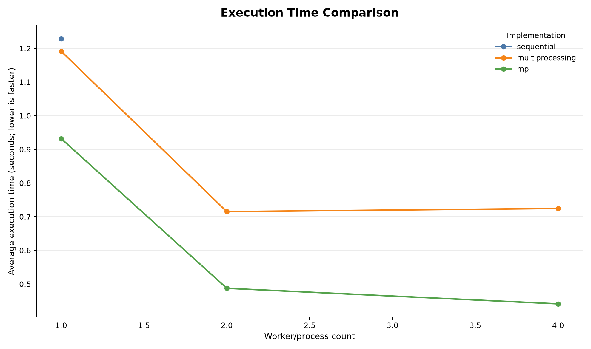
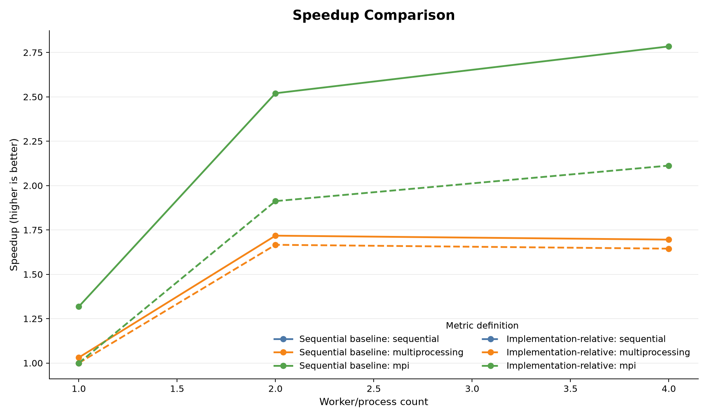
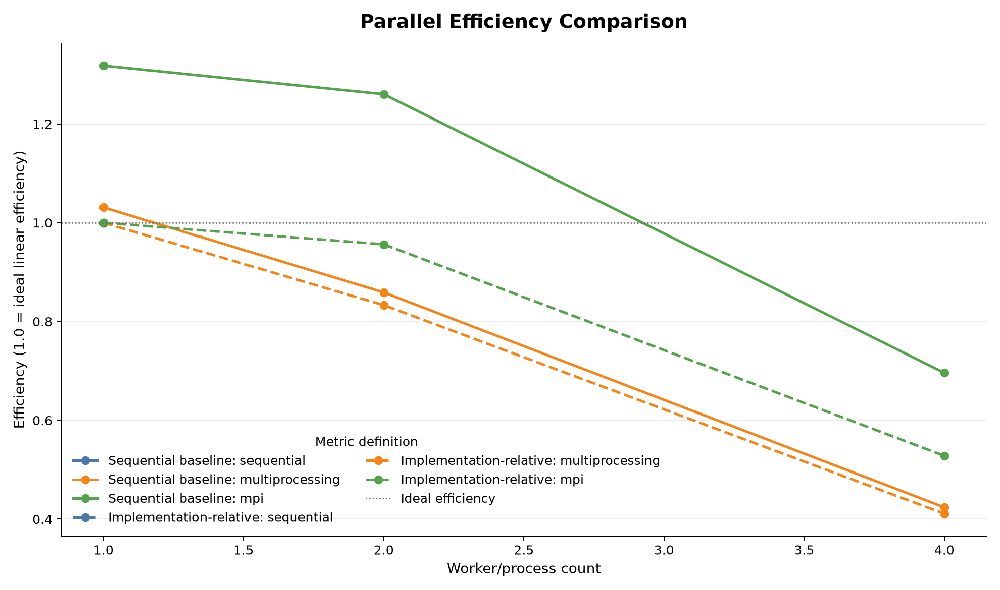
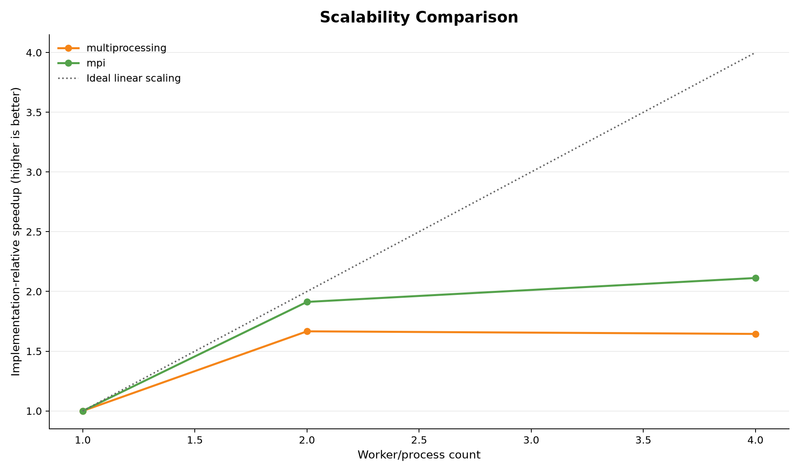
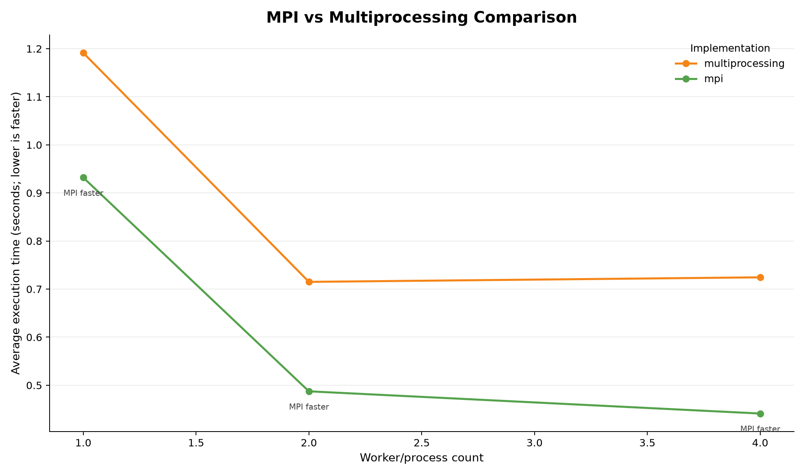

# ParallelLab-MPI

## Hi 👋, I'm Sumair Ahmed Dero

### AI Student • Machine Learning Engineer • Computer Vision & Intelligent Applications

[](https://github.com/SUMAIRDERO62)
[](https://www.linkedin.com/in/sumair-ahmed-dero-70ba852a0/)
[](https://sumair-ahmed-dero-ai-journey.vercel.app/)

> I build practical AI systems, experiment with intelligent applications, and
> turn ideas into useful software—from data and models to APIs, dashboards,
> testing, and deployment.

### About me

- Pursuing a **BS in Artificial Intelligence at the University of Sindh**
- Focused on **Machine Learning, Deep Learning, Computer Vision, NLP, and
  Generative AI**
- Previously worked as a **Machine Learning Intern at R-Technologies**
- Building AI-powered tools, analytics dashboards, intelligent assistants, and
  production-minded applications
- Learning **Microsoft Azure, MLOps, cloud deployment, and scalable AI systems**
- Interested in explainable AI, automation, model evaluation, and responsible
  technology
- Open to internships, collaboration, research discussions, freelance work, and
  meaningful technical projects

## Project overview

ParallelLab-MPI is a Python parallel-computing semester project comparing the
same deterministic CPU-bound workload across three execution models:

1. Sequential Python
2. Python `multiprocessing`
3. MPI through `mpi4py`

Each implementation calculates:

```text
1^2 + 2^2 + ... + n^2
```

The project measures execution time, validates identical results, computes
performance metrics, and produces report-ready visualizations. The repository
is maintained at [SUMAIRDERO62/ParallelLab-MPI](https://github.com/SUMAIRDERO62/ParallelLab-MPI).

## Objectives and problem statement

The project studies how a simple CPU-bound workload behaves when divided among
local worker processes or MPI ranks. It addresses:

- How to partition `1..n` without overlap or omission.
- How sequential, multiprocessing, and MPI execution compare.
- How worker count affects speedup, efficiency, and scalability.
- How process creation, synchronization, communication, and reduction overhead
  affect a small workload.
- How to preserve reproducible benchmark data while separating measurement,
  analysis, and visualization.

## Current project status

Phase 6 currently includes:

- Sequential, multiprocessing, and MPI implementations.
- Balanced range partitioning and correctness checks.
- Repeated benchmark execution with CSV output.
- A validated performance-analysis engine.
- Sequential-baseline and implementation-relative metrics.
- MPI-versus-multiprocessing comparison data.
- Five professional performance charts plus the two legacy charts.
- Automated correctness, analysis, validation, and visualization tests.
- Architecture, methodology, results, and project-summary documentation.
- A professional README and focused documentation guides.

The performance report and later Phase 6 work are not included in this step.

## Architecture

```text
ParallelLab-MPI/
├── src/parallel_lab/
│   ├── common.py                 # Shared sum and balanced partition helpers
│   ├── sequential.py             # Single-process reference implementation
│   ├── multiprocessing_sum.py   # multiprocessing.Pool implementation
│   ├── mpi_sum.py               # mpi4py implementation
│   ├── benchmark.py              # Repeated measurements and raw CSV output
│   ├── analysis.py               # Validation and derived performance metrics
│   └── visualization.py          # Legacy and Phase 6 chart generation
├── tests/test_parallel.py        # Unit, analysis, and visualization tests
├── results/
│   ├── benchmark_results.csv    # Raw checked-in benchmark measurements
│   ├── performance_analysis.csv # Derived analysis metrics
│   ├── execution_time.png       # Legacy chart
│   ├── speedup.png              # Legacy chart
│   └── *_comparison.png         # Five Phase 6 charts
├── docs/
│   ├── PROJECT_OVERVIEW.md
│   ├── INSTALLATION.md
│   ├── EXECUTION_GUIDE.md
│   ├── PERFORMANCE_ANALYSIS.md
│   ├── architecture.md
│   ├── methodology.md
│   ├── results-analysis.md
│   └── project-summary.md
├── requirements.txt
└── README.md
```

See the [architecture documentation](docs/architecture.md) for the execution
and communication flow.

Documentation index:

- [Project overview](docs/PROJECT_OVERVIEW.md)
- [Installation](docs/INSTALLATION.md)
- [Execution guide](docs/EXECUTION_GUIDE.md)
- [Performance analysis](docs/PERFORMANCE_ANALYSIS.md)
- [Detailed methodology](docs/methodology.md)
- [Recorded results](docs/results-analysis.md)

## Technologies

- Python 3
- `mpi4py==4.1.2`
- Microsoft MPI or another Windows MPI implementation providing `mpiexec`
- Python `multiprocessing.Pool`
- pandas and Matplotlib
- pytest for automated tests
- Windows PowerShell

## Installation on Windows

From the repository root:

```powershell
py -3 -m venv .venv
.\.venv\Scripts\Activate.ps1
python -m pip install --upgrade pip
python -m pip install -r requirements.txt
python -m pip install pytest
```

If PowerShell activation is restricted, use the interpreter directly:

```powershell
.\.venv\Scripts\python.exe -m pip install -r requirements.txt
.\.venv\Scripts\python.exe -m pip install pytest
```

Install Microsoft MPI, or another compatible MPI implementation, separately
and ensure `mpiexec` is available. The benchmark launcher also checks common
MPI locations inside the active environment before searching `PATH`.

The project uses a `src` layout. Set `PYTHONPATH` in each PowerShell session:

```powershell
$env:PYTHONPATH = "$PWD\src"
```

## Run the implementations

Sequential reference:

```powershell
python -m parallel_lab.sequential
```

Multiprocessing with four workers:

```powershell
python -m parallel_lab.multiprocessing_sum --n 5000000 --processes 4
```

MPI with four ranks:

```powershell
mpiexec -n 4 python -m parallel_lab.mpi_sum --n 5000000
```

MPI with machine-readable JSON output:

```powershell
mpiexec -n 4 python -m parallel_lab.mpi_sum --n 5000000 --json
```

For `n=5,000,000`, the checked-in benchmark result is
`41666679166667500000` for every implementation and worker configuration.

## Tests

With `PYTHONPATH` configured:

```powershell
python -m pytest -q
```

The test suite covers partitioning, result consistency, input validation,
metric calculations, CSV generation, chart generation, temporary output
directories, image validity, and preservation of source benchmark data.

## Benchmark and analysis workflow

Run the default benchmark. This writes the raw benchmark CSV:

```powershell
python -m parallel_lab.benchmark
```

The default uses `n=5,000,000`, three repetitions, and worker counts `1`, `2`,
and `4`. To choose values explicitly:

```powershell
python -m parallel_lab.benchmark `
  --n 5000000 --repeats 3 --processes 1 2 4
```

Generate the separate performance-analysis CSV without changing the raw CSV:

```powershell
python -m parallel_lab.analysis `
  --input results\benchmark_results.csv `
  --output results\performance_analysis.csv
```

The analysis engine validates required columns, data types, supported
implementations, duplicate worker configurations, positive timings, baseline
rows, and consistent workload metadata.

## Visualizations

Generate all five Phase 6 charts and preserve the two legacy charts:

```powershell
python -m parallel_lab.visualization `
  --benchmark results\benchmark_results.csv `
  --analysis results\performance_analysis.csv `
  --output-dir results
```

The five professional charts are:

1. [Execution time comparison](results/execution_time_comparison.png) —
   measured average time for sequential, multiprocessing, and MPI; lower is
   faster.
2. [Speedup comparison](results/speedup_comparison.png) — sequential-baseline
   speedup and implementation-relative speedup shown with distinct line styles.
3. [Efficiency comparison](results/efficiency_comparison.png) —
   sequential-baseline and implementation-relative efficiency.
4. [Scalability comparison](results/scalability_comparison.png) —
   multiprocessing and MPI implementation-relative speedup against ideal
   linear scaling.
5. [MPI versus multiprocessing](results/mpi_vs_multiprocessing.png) —
   execution times at matching worker counts, with the faster measured
   implementation identified for each point.

### Chart previews











The original [execution-time](results/execution_time.png) and
[speedup](results/speedup.png) charts remain available for compatibility.

## Benchmark methodology

The raw benchmark records arithmetic means across three repetitions. The
sequential timer covers the calculation. The multiprocessing timer includes
pool creation, task execution, result collection, and pool cleanup. The MPI
timer starts after a barrier and reports the maximum local computation time
across ranks; MPI launch and process startup are outside that interval.

Metrics use two distinct baselines:

```text
sequential_baseline_speedup = sequential_time / current_time
sequential_baseline_efficiency = sequential_baseline_speedup / workers

implementation_relative_speedup = one_worker_time / current_time
implementation_relative_efficiency = implementation_relative_speedup / workers
```

The [methodology document](docs/methodology.md) describes these boundaries and
limitations in detail.

## Recorded benchmark results

The checked-in [benchmark CSV](results/benchmark_results.csv) uses
`n=5,000,000`, three repetitions, and reports the following measured averages:

| Implementation | Workers | Average time (s) | Sequential speedup | Sequential efficiency |
|---|---:|---:|---:|---:|
| Sequential | 1 | 1.228292 | 1.000000 | 1.000000 |
| Multiprocessing | 1 | 1.191418 | 1.030950 | 1.030950 |
| Multiprocessing | 2 | 0.715021 | 1.717841 | 0.858921 |
| Multiprocessing | 4 | 0.724475 | 1.695424 | 0.423856 |
| MPI | 1 | 0.932027 | 1.317872 | 1.317872 |
| MPI | 2 | 0.487354 | 2.520329 | 1.260165 |
| MPI | 4 | 0.441152 | 2.784283 | 0.696071 |

These are observations from the checked-in run only. They are not
hardware-independent claims. The current [results analysis](docs/results-analysis.md)
also includes implementation-relative metrics and matched-worker comparisons.

## Limitations and future improvements

- The checked-in data uses one workload size and three repetitions.
- Timings are sensitive to CPU load, scheduling, Python version, MPI runtime,
  process affinity, and background activity.
- MPI and multiprocessing use different timing boundaries.
- The workload has simple arithmetic and little communication, so it does not
  represent every distributed application.
- Future work can add warm-up runs, input-size sweeps, variability statistics,
  confidence intervals, affinity controls, communication profiling, and
  automated result archiving.

Further details are available in the [architecture](docs/architecture.md),
[methodology](docs/methodology.md), and
[project summary](docs/project-summary.md).
