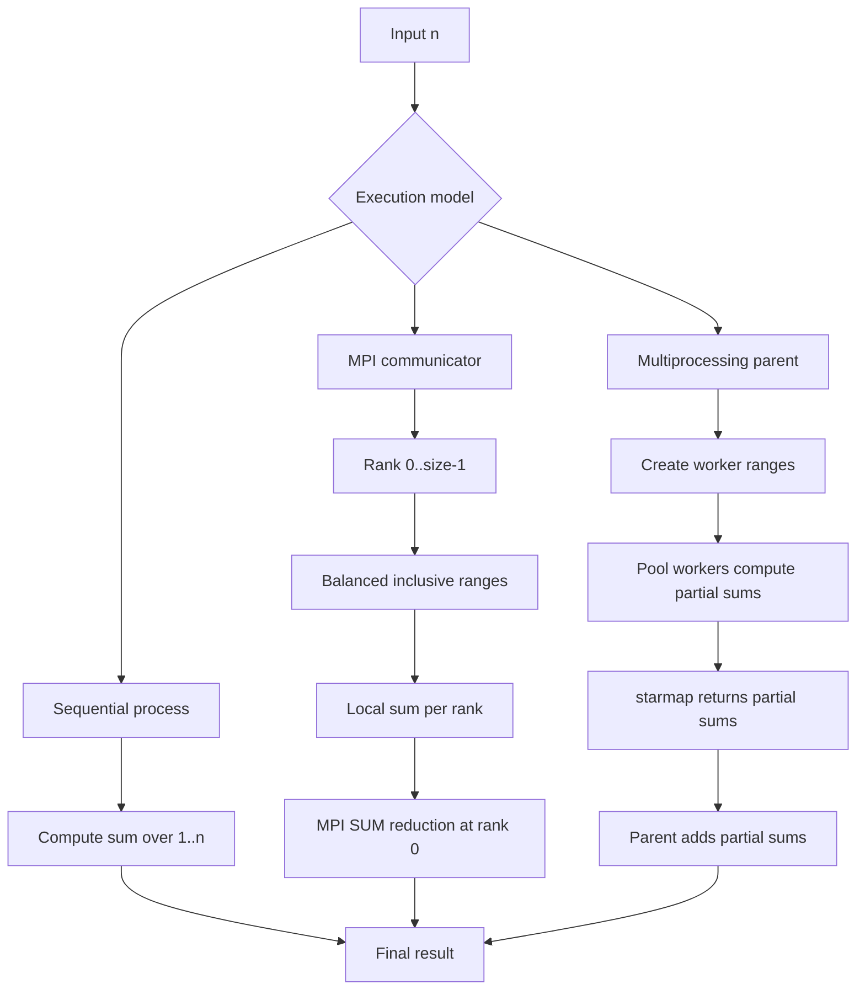

# Architecture

ParallelLab-MPI evaluates one deterministic workload through three execution
models. The workload is the inclusive sum of squares from `1` through `n`.
`common.py` contains the shared range-partitioning and partial-sum logic so
that the implementations differ primarily in how work is scheduled and how
partial results are aggregated.

## Sequential architecture

`sequential.py` runs one Python process. It iterates over all values from `1`
through `n`, accumulates the sum, and measures the calculation with
`time.perf_counter()`. This is the reference time used to calculate speedup.

## MPI architecture

`mpi_sum.py` runs one Python process per MPI rank in `MPI.COMM_WORLD`:

1. Each rank obtains its `rank` and the total communicator `size`.
2. `partition_range` assigns a balanced, non-overlapping inclusive interval.
   The first `n % size` ranks receive one additional value.
3. All ranks synchronize with `comm.Barrier()`.
4. Each rank computes its local sum.
5. `comm.reduce(..., op=MPI.SUM, root=0)` combines local sums at rank 0.
6. A second reduction with `MPI.MAX` selects the slowest local elapsed time,
   which represents the parallel calculation time reported by rank 0.

Only rank 0 prints the final result, process count, and elapsed time. MPI
launch and process startup are external overheads and are not included in the
local `MPI.Wtime()` interval used by this implementation.

## Multiprocessing architecture

`multiprocessing_sum.py` creates one `multiprocessing.Pool` with the requested
number of worker processes. The parent creates one range for each worker and
uses `pool.starmap` to call the shared sum-of-squares helper. The parent then
adds the returned partial sums. Its timer surrounds pool creation, task
execution, result transfer, and pool cleanup.

## Work distribution and aggregation

The partitioning helper also represents an empty range as `(1, 0)` when more
workers than input values are requested; the shared helper treats that range
as contributing zero.
